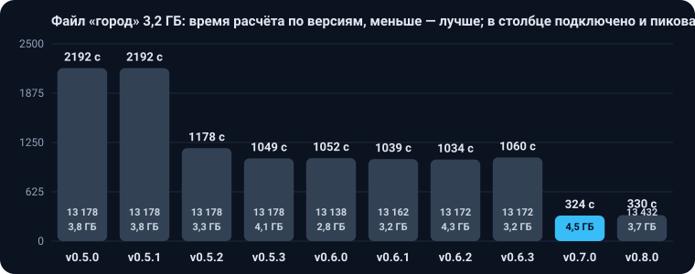

# История версий

S варианта 1 на датасете организаторов по версиям, время расчёта и что изменилось. Текущая версия — **v0.13.0**,
вернуться к ней: `git checkout v0.13.0`. Как выпускается версия — в [CONTRIBUTING.md](docs/CONTRIBUTING.md#версии).

## Не выпущено

Пока ничего.

## Датасет организаторов

Замер на датасете организаторов `data/real/dataset.geojson`: S и стоимость варианта 1 из `variant_summary`, время — стенные секунды расчёта через CLI. Машина: MacBook, 11 ядер, 18 ГБ, один процесс. Отсчёт начат заново с версии 0.5.0: организаторы 18.09.2026 выпустили новую редакцию правил ([что изменилось](docs/architecture/CONSTRAINTS.md#19-редакция-технического-приложения-от-18092026)), и прежние S несравнимы с нынешними — по старым правилам здание с точкой подключения было проходимым, а стоимость включала реконструкцию. Как менялось качество на сценах «густо» и городе — в [research.md](docs/research.md).

**Метрика на датасете организаторов** — S варианта 1, первого по рангу, из `variant_summary`: S = 0,7 · стоимость / 25 млн руб. + 0,3 · длина новой сети / 100 м, меньше — лучше (п. 7.2 ТЗ). В v0.13.0 она равна **12,6947**: стоимость 259,4 млн руб., все 17 точек подключены, строгий `check18` без замечаний. Вариант 2 — 12,929, на скорректированном датасете — 12,935; третьего варианта нет. В v0.12.0 вариант 1 был 12,6962, варианты 2 и 3 — 12,9102 и 13,0306, на скорректированном датасете 13,0064 и 13,1268. В v0.10.0–v0.11.1 вариант 1 был 12,7841, варианты 2 и 3 — 12,9981 и 13,1185, на скорректированном датасете 13,0943 и 13,2147. Без ортогональной формы (`-Dheatnet.square=false`) S = 12,4044.

**После встречи с организаторами 16.10.2026** к правилам 18.09 добавились замечания экспертов к форме трасс:
- трасса прямыми вдоль осей застройки;
- один поворот 90° вместо двух по 45°;
- без изломов вдоль коридоров.

Такая трасса длиннее, поэтому S версий начиная с v0.10.0 нужно сравнивать между собой, а не с v0.9.0. Так, v0.9.0 без этих требований давал 12,748, а голова ветки замечаний экспертов до точного скелета — 13,1574. На графике версии до и после встречи разделены пунктирной линией.

Время v0.10.0 и v0.11.0 — замер на ВМ с 4 ядрами под Java 11, как требует ТЗ; на MacBook не мерили. На той же ВМ под Java 11 v0.9.0 считается 9 с, голова ветки замечаний экспертов — 12 с, v0.10.0 — 33 с, v0.11.0 — 51 с: точный скелет строится для каждого черновика, а не только для лучшего. Почти всё добавленное время уходит на точную динамику по 11 сеткам: она даёт выигрыш S, а с одной сеткой 20 м S остаётся 13,1574. Под Java 21 v0.10.0 считается 21 с: Java 11 не векторизует внутренние циклы динамики.

Время v0.11.1 — замер на MacBook (M3 Pro, 11 ядер, Java 11), на ВМ не мерили: датасет организаторов 10 с всего вместо 21 с у v0.11.0 на той же машине, сам расчёт (`PIPELINE DONE`) 9,6–10,0 с вместо 14,8–15,0 с. Выход тот же побайтово. Ускорения: старт CLI без поиска имени хоста и автоконфигураций (5,7 → 0,4 с), отсечение в динамике по нижним оценкам остатка дерева с повтором без отсечения, если оптимум дороже границы, `Math.min` во внутренних циклах (Java 11 на arm64 векторизует его, а сравнение — нет), кэш скелета одного дерева в разных черновиках, общий пул деревьев черновиков, память переносов в доводке формы; описание — в [ARCHITECTURE.md](docs/architecture/ARCHITECTURE.md).

| Версия | Дата | S | Стоимость, млн руб. | Время, с | Что изменилось |
|---|---|---|---|---|---|
| v0.13.0 | 20.10.2026 | 12,695 | 259,4 | 17 | исправления по 164 сценам из OpenStreetMap (генератор и ожидания — `tools/scenes`): отвод от трубы врезки поперёк, а не вдоль существующей трубы; поиск врезки дальше 150 м и по графам следующих Ду вместо ложного «нет маршрута»; ввод от ближней стены; группа сверх Ду 1400 делится на дома вместо падения; причина `no_route` перечисляет мешающие объекты в `object_ids`; переход пучка «дорога + линии» одним прямым поперечным спецпроходом; отличие места врезки вариантов по правилу 10 м; ввод приходит в камеру ветвления одной прямой, без двух поворотов через короткое звено (ОКС 7 датасета). На сценах все обязательные ожидания и `check18` выполняют 144 из 164 вместо 129, нарушений обязательных ожиданий 31 вместо 57. Датасет организаторов: S 12,6962 → 12,6947, два варианта вместо трёх (вариант 2 — 12,929, на скорректированном датасете 12,935). e4-combined 13,2275 → 13,2988: ушло сближение с сетью B11, появились два конца спецпрохода в 2,7 м от дороги при норме 3 м (B12). Остались изломы через короткое звено примерно в 15 сценах, в том числе у ОКС 13 датасета (с v0.12.0), и ввод не от ближайшей стены у ОКС 2 и 10 — ради S. В версию вошли также: Ранги вариантов идут подряд с 1 и тогда, когда вариант не прошёл отбор: раньше на входе с точкой, которую не подключить, оба выданных варианта получали `rank = 2`. `check18` в проверке E8 теперь требует ранги 1, 2, 3 по возрастанию score. Выход на датасетах организаторов прежний.; Варианты 2 и 3 без колена у камеры: черновик, где поворот круче 90° разбит коротким звеном (разъяснение 18 от 29.09), при выборе скелета дерева уступает черновику без колена. На скорректированном датасете варианты 2 и 3 — 13,0064 → 12,9921 и 13,1268 → 13,1125, вариант 1 побайтово прежний; на исходном датасете, наборах экспертов, сценах medium и «густо», в Питере и Москве выход прежний. Время на скорректированном датасете — медиана пяти пар 10,5 → 10,7 с.; В городском режиме по умолчанию нет срока: районы и второй проход по точкам без сети считаются до конца, точки не остаются без сети из-за времени (п. 2.5, разъяснение 4 от 29.09: лимита времени нет). Прежний срок задаётся параметрами `heatnet.city.deadline` и `heatnet.city.retry.deadline`. Время города без срока ещё не мерили.; Демо платформы пересчитаны текущей версией: small-1 — три варианта 12,6962 / 12,9921 / 13,1125 вместо двух от 16.10 (13,6408 и 13,9711), Купчино с глубиной — S 75,5379 по итоговой сборке. Платформа считает уклон по длине участка из выхода сервиса (EPSG:32637), а не по своей проекции: в Петербурге прежний счёт находил у 11 участков ложный уклон больше 0,10.; Режим с глубиной учитывает канализацию: условный верх 3,5 м, габарит 0,4 м, просвет 0,2 м по СП 124.13330 табл. А.1. В приложении её нет, поэтому тип мягкий: на цепочке, где профиль с ней не помещается в уклон 0,10, она не учитывается. Москва — 114 пересечений с канализацией без ручной проработки, Петербург — 14, S 75,554 → 75,5668. На датасетах организаторов канализации нет, выход прежний. Платформа больше не считает пересечением трубу, на которой стоит камера участка, и проверяет просвет до канализации 0,2 м; в демо Купчино проблем по высоте 0 вместо 10.; Режим с глубиной: камера стоит на 3,0 м со строительным допуском ±5 см вместо ±1 см, и внутри допуска её глубина выбирается по стоимости профиля; сдвиг дальше допуска — только когда иначе профиля нет, и тогда самый дешёвый. Канализацию сервис перестаёт учитывать на цепочке, только если не помог и сдвиг камеры, а соблюдённые пересечения с ней остаются в `depth_crossings`. В профиле нет кусков короче 1 см у узлов, изломов внутри спуска и лишнего возврата на 3,0 м между глубокой и мелкой зоной. Петербург — S 75,5668 → 75,5379, надбавка Kгл 1,03 млн ₽ → 0; Москва — 369,9264 → 369,9227, в `depth_crossings` 119 пересечений с канализацией вместо 114; на датасетах организаторов выход прежний. Флаг `depth_shifted` у камеры — только при сдвиге больше 5 см.; Из репозитория убраны рабочие черновики: разборы и прогоны городов, пакет доработок после встречи 16.10, журналы UX-ревью платформы, отладочный вывод, мёртвый код и все комментарии в коде. Байткод Java и выход проверщика от этого не изменились. |
| v0.12.0 | 19.10.2026 | 12,696 | 259,4 | 12 | вход в здание у угла (разъяснения 29.09, п. 15 и 17): если точка стоит у угла, финальный участок может идти от ближайшей точки другой стороны контура, когда эта сторона дальше ближайшей не больше чем на 1 м. Сервис берёт такой вход в готовых вариантах, только если поворотов становится меньше, S не растёт и прямой угол сохраняется; другая точка той же стороны не допускается. На датасете организаторов петля у ОКС 15 заменена входом через соседнюю стену: ветка 176 → 160 м, три поворота → два. Варианты 2 и 3 — 12,9981 → 12,9102 и 13,1185 → 13,0306, на скорректированном датасете 13,0943 → 13,0064 и 13,2147 → 13,1268; e4-combined 13,3153 → 13,2275; Питер 75,5386 → 75,5375 (у одной ветки ушёл излом 14°); Москва — тот же выход, городской режим этой правки не делает. `check18` показывает вход у угла справочной строкой, любой другой вход не в ближайшей точке остаётся B8. Время замерено на загруженной машине, main в тех же парах 11,6–13,3 с. В версию вошли платформа «Тепломаршрут» с ручной правкой трассы и раскладка документации по `docs/`: выход сервиса они не меняют |
| v0.11.1 | 18.10.2026 | 12,784 | 260,9 | 10 | выход побайтово как у v0.11.0 на обоих датасетах организаторов, наборе с газом, `case_2d_noroute`, Питере и в режиме глубины; Москва — то же, кроме номеров камер. Время на MacBook: 21 → 10 с всего, расчёт 15 → 10 с; Москва ~50 → ~43 с. Динамика точного скелета отсекает состояния по нижним оценкам остатка (MST/2 и путь до врезки по метрическому замыканию), граница на следующих сетках — оптимум прошлой ×1,03; прежнее правило по прямому весу до врезки оставлено с прежней границей, потому что веса маршрутов не метрика. Старт CLI 5,7 → 0,4 с. В версию вошёл режим с учётом глубины: CLI `--depth`, API `?depth=true`, проверка `check18.py --depth`; на датасетах организаторов стоимость профиля равна доказанной нижней границе ([описание](docs/depth-optimization.md)) |
| v0.11.0 | 17.10.2026 | 12,784 | 260,9 | 51 | точный скелет на сетках 21–30 м строится для каждого черновика, не только для лучшего. Выбор в два прохода: черновик варианта 1 — по прежним правилам и без камер, которые можно сдвинуть к прямому углу; варианты 2–3 — ещё и по длине не по осям, с проходом, который сдвигает такие камеры. Вариант 1 тот же, вариант 2 — 13,446 → 13,094 (пар 2 → 1), вариант 3 — 13,566 → 13,215 (пар 4 → 3); на копиях датасета варианты 2–3 лучше на 0,15–0,44, новых нарушений check18 нет. Время под Java 11 33 → 51 с |
| v0.10.0 | 17.10.2026 | 12,784 | 260,9 | 33 | первая версия после встречи с организаторами 16.10.2026. Форма трасс по замечаниям экспертов: прямые по осям застройки, один поворот 90° вместо двух по 45°, пары поворотов 60–120° со звеном короче 30 м заменяются одной вершиной, колено у камеры; S 12,748 → 13,157 — цена формы. Точный скелет дерева врезки: динамика Дрейфуса–Вагнера на сетках мест камер 20–30 м, берётся, только если после проходов формы не хуже по S, точкам без сети, поворотам, парам и дефектам формы; S 13,157 → 12,784, поворотов 23 → 18, пар 0. Без ортогональной формы 12,541. Кэш маршрутов не больше половины кучи, тесты с `-Xmx256m` проходят |
| v0.9.0 | 27.09.2026 | 12,748 | 265,8 | 3 | строгая форма трасс по п. 5: нет плавных дуг, лишних вершин, двойных поворотов и зигзагов, в check18 проверки B16–B21; звено после выхода из здания вместо отказа ветки; рёбра вариантов по графу своего Ду; перенос камер ветвления и общие камеры врезки; поворот в камере на пути точки не круче 90°, изломы у камер снимаются сдвигом камеры, финальный луч не заходит повторно в зону своего здания; спецпроходы по 3 м вдоль трассы, обычный участок у пересечения линии не ближе нормы, дорога осью, врезка у перпендикуляра; точные ускорения графа, Дейкстры и формы. Один вариант, 17 точек из 17, «густо» 52,528 / 101,971 / 219,261, medium 23,758 / 19,006 / 19,932; v0.8.1 в тех же прогонах 4,0–4,4 с; [отчёт](docs/performance.md) |
| v0.8.1 | 26.09.2026 | 13,230 | 270,0 | 4 | расчёт быстрее при побайтово том же выходе: перебор узлов графа для цели ограничен лучшим найденным весом, на шаге сборки дерева сравниваются только новые цели; датасет 3,65 с вместо 4,65, районы города в 1,2 раза быстрее; [отчёт](docs/performance.md) |
| v0.8.0 | 26.09.2026 | 13,230 | 270,0 | 5 | выход из здания не уходит на дальнюю сторону, когда ближняя открыта (п. 2.2): точка, у которой нет ветки от выхода у ближней стены, уходит из дерева и подключается отдельно; в v0.7.0 так вышла точка 4 датасета. Варианты 2 и 3 — 13,344 и 13,428 вместо 13,422 и 13,818, «густо», medium и 203 сценария без изменений. `check18` дополнительно проверяет ближнюю сторону здания, углы и полосы спецпроходов, пересечение сети вне врезки, касания новых участков и ограничения неизвестных типов; [отчёт](docs/performance.md) |
| v0.7.0 | 25.09.2026 | 12,866 | 264,6 | 5 | зоны отступа по точному расстоянию до здания вместо буфера с острыми углами, срезка углов трасс хордой, перенос врезки к вершине ствола и ствол заново от первой камеры ветвления, третий вариант от блоков второго, выход из здания у ближней стены по Ду участка; застой поиска 100 и бюджет 1000; «густо» 53,188 / 109,373 / 225,245 вместо 56,126 / 115,644 / 233,268, на 203 сценариях вариант 1 лучше в 27 и нигде не хуже; расчёт в 1,3–2 раза быстрее: сетка зон в графе, чтение байтовым сканером, прямые подключения и критерии города параллельно; [отчёт](docs/performance.md) |
| v0.6.3 | 23.09.2026 | 13,729 | 279,3 | 7 | повторная работа убрана без изменения выхода: проверка выхода из своего здания идёт после дешёвых проверок и запоминается, деревья черновика отсеиваются по рамкам, полоса трассы черновика строится один раз; бюджет поиска 600 вместо 300 — на «густо» 100 и 200 поиск останавливается сам и даёт S 115,644 и 233,268 вместо 116,151 и 234,161, «густо-200» считается 14 с вместо 27; [история поиска](docs/research.md) |
| v0.6.2 | 23.09.2026 | 13,729 | 279,3 | 9 | точный поиск маршрута для точки, которая иначе остаётся без сети: состояние «узел и откуда в него пришли» на широкой области, предел 100 тыс. состояний. Он находит путь, в который нужно войти с другой стороны, и заменил ограничение первого поворота из 0.6.1. Выход на датасете организаторов побайтово тот же; «густо-100» подключает все 100 точек вместо 99, стоимость ниже ещё на 61 млн, время 10 с вместо 8 |
| v0.6.1 | 23.09.2026 | 13,729 | 279,3 | 9 | точка, у которой не осталось ни одного варианта, подключается маршрутом вдоль финального прямого участка: раньше такую ветку выбрасывал поворот в точке выхода из здания круче 90°, и точка оставалась со штрафом от 100 млн. Выход на датасете организаторов побайтово тот же; «густо» 50/100/200 — подключено 50/99/200 вместо 50/98/199, стоимость сцен 100 и 200 ниже на 63 и 70 млн; город подключает на 24 точки больше за 1039 с |
| v0.6.0 | 22.09.2026 | 13,729 | 279,3 | 9 | правила п. 2.2 и 1.1 строго: финальный участок только от ближайшей точки контура (другая сторона лишь при чужой зоне или повторном входе в своё здание, перебор трёх сторон по S убран), участок не проходит сквозь другое крыло своего здания, `check18` считает такой проход нарушением; читатель принимает любую геометрию ограничения любого типа (дорога или река линией не роняют расчёт); S 13,019 → 13,729 — цена строгого чтения |
| v0.5.3 | 22.09.2026 | 13,019 | 265,6 | 6 | город без изменения результата: критерии считают «дальше досягаемости» один раз на все варианты и считают причины неподключения параллельно без перебора 3 млн ОКС на каждую, точки вне рамки сети не ищут кандидатов прямого подключения, расстояния до сети параллельно; город 1049 с вместо 1178 при тех же 13 178 подключённых; выход на датасете организаторов и «густо» побайтово тот же |
| v0.5.2 | 22.09.2026 | 13,019 | 265,6 | 6 | время без потери качества: кэш зон отступа при проверке дерева, деревья кандидатов врезки параллельно (выход побайтово тот же), город без зданий дальше 11,3 км от сети (память 3,8 → 3,3 ГБ), оба варианта города за один проход прямых подключений, коридор графа района, срок на районы 15 минут вместо 30 (город 1178 с вместо 2192 при тех же 13 178 подключённых); проверка гипотез T1–T8 — в [docs/research.md](docs/research.md) |
| v0.5.1 | 22.09.2026 | 13,019 | 265,6 | 16 | выход из здания через одну из трёх ближайших сторон, а не только через ближайшую (S 13,492 → 13,019, на сценах «густо» подключены все точки); варианты 2 и 3 добираются ходами от лучшего черновика, порог схожести трасс 0,9 (три варианта 13,019 / 13,026 / 13,043 вместо двух); проверка гипотез Q1–Q7 — в [docs/research.md](docs/research.md) |
| v0.5.0 | 22.09.2026 | 13,492 | 271,1 | 21 | правила технического приложения от 18.09.2026: все здания — препятствия с финальным прямым участком в своё, без реконструкции и объекта `tie_in`, врезка через камеру, ДУ постоянен между узлами смены расхода и по предельной длине каждого пути, повороты до 90° без надбавки, спецпроход одним прямым участком, новая сводка; город: прямые подключения точек у сети (13 178 вместо 952), точки дальше 11,3 км от сети недостижимы по предельной длине, дальние районы — до срока 30 минут |

История версий по прежним правилам

| Версия | Дата | S | Стоимость, млн руб. | Время, с | Что изменилось |
|---|---|---|---|---|---|
| v0.4.2 | 22.09.2026 | 12,596 | 260,0 | 8 | расчёт большого входа по районам: файл «город» на 3,2 ГБ считается за 2,5 минуты вместо недостижимого прежде конца; параллельное чтение, ускоренные точные проверки геометрии, исправлены вырожденные трассы у точек подключения вплотную к трубам; выход на датасете и сценах `medium` побайтно как у 0.4.1 |
| v0.4.1 | 18.09.2026 | 12,596 | 260,0 | 23 | ранний выход локального поиска после плато (`heatnet.search.stall=50`, потолок по-прежнему 300 сборок): выход на датасете побайтно как у 0.4.0, время CLI ~23 с вместо ~51 с на той же машине |
| v0.4.0 | 17.09.2026 | 12,596 | 260,0 | 51 | врезки выше реконструкции: кандидаты в объектах сети над реконструируемыми участками, пересадка лучших деревьев на них с сохранением рёбер, граф подмножества по диаметру его расхода (H-6); реконструкция на датасете 21,2 → 0 млн руб., сумма S стенда 307,1 → 287,4; время мерили при нагрузке от других процессов |
| v0.3.4 | 17.09.2026 | 13,149 | 276,0 | 46 | общий кэш маршрутов с потолком 1 ГБ, чтение без дальних зданий и ограничений: на входе с 200 тыс. зданий куча 434 → 154 МБ и процессорное время 82 → 61 с; выход на датасете и в 221 сценарии тот же, что у 0.3.3, время датасета не мерили на свободной машине, процессорное время прежнее |
| v0.3.3 | 17.09.2026 | 13,149 | 276,0 | 46 | пространственный индекс препятствий: на входе с 200 тыс. зданий расчёт на треть быстрее; выход на датасете тот же, что у 0.3.2, время датасета не мерили на свободной машине, процессорное время прежнее |
| v0.3.2 | 17.09.2026 | 13,149 | 276,0 | 46 | подмена файла правил и пример водопровода, дополнительные критерии и причины неподключения в сводке API и файле CLI, офлайн-карта результата `make viz`; выход на датасете тот же, что у 0.3.1 |
| v0.3.1 | 16.09.2026 | 13,149 | 276,0 | 46 | надбавки к целям присоединения ветки (H-1), стенд `scripts/bench.sh`; выход на датасете тот же, что у 0.3.0 |
| v0.3.0 | 16.09.2026 | 13,149 | 276,0 | 51 | поиск детерминирован по бюджету 300 сборок, кэш таблиц Дейкстры, отсечение целей, перезапуск поиска от лучшего черновика |
| v0.2.0 | 16.09.2026 | 14,012 | 297,4 | 73 | протокол организаторов 16.09.2026: трассы по сетке 45° и коэффициент 1,5 за нестандартный угол, врезка на каждую ветку из камеры, `heat_load` справочный, деление спецучастка по коэффициенту, сборка Gradle |
| v0.1.0 | 16.09.2026 | 16,762 | 359,4 | 69 | граф видимости по касательным рёбрам, локальный поиск по разбиениям с пределом 60 с; S посчитан по правилам до протокола 16.09.2026 и с последующими версиями напрямую не сравнивается |

## Город: синтетический файл на 3,2 ГБ

Файл `data/synth/city-1.geojson`: 3,2 ГБ, 3 143 825 точек подключения; в репозитории его нет. Считается через CLI при `-Xmx12g -XX:MaxNewSize=512m`, время — стенные секунды, память — пиковый RSS. 3 079 776 точек лежат дальше 11 276 м от сети и недостижимы при любом Ду, поэтому подключено 13 178 в версиях до 0.6.0, 13 138 в 0.6.0, 13 162 в 0.6.1, 13 172 в 0.6.2, 13 438 в 0.7.0, 13 432 в 0.8.0 и 0.8.1 и 12 681 в 0.9.0: камера врезки больше не ставится в дорогу, и часть прямых подключений уходит в районы.

| Версия | Подключено | S варианта 1 | Время, с | Память, ГБ | Что изменилось |
|---|---|---|---|---|---|
| v0.9.0 | 12 681 | 3 131 144 | 335 | 4,5 | v0.8.1 в той же паре прогонов 333 с; на 751 точку меньше: камера врезки не ставится в дорогу, срок районов 275 с |
| v0.8.1 | 13 432 | 9 640 771 | 326 | 3,5 | районы в 1,2 раза быстрее: до срока 300 с начато 2092 района вместо 1888, выход тот же |
| v0.8.0 | 13 432 | 9 640 771 | 330 | 3,7 | выход с дальней стороны здания при открытой ближней запрещён, 6 точек остались без сети |
| v0.7.0 | 13 438 | 9 640 776 | 324 | 4,5 | районы в 3–7 раз быстрее, срок на районы 5 минут вместо 15 при том же наборе подключений; точки у трубы внутри своего здания подключаются врезкой со сдвигом вдоль трубы; по сводке подключено на 273 ОКС больше, чем в v0.6.3 (13 165) |
| v0.6.3 | 13 172 | 9 641 636 | 1060 | 3,2 | результат тот же; время при чужой загрузке машины до 60 |
| v0.6.2 | 13 172 | 9 641 636 | 1034 | 4,3 | точный поиск в запасном ходе: ещё 10 подключённых точек |
| v0.6.1 | 13 162 | 9 641 649 | 1039 | 3,2 | точки, отбракованные поворотом в точке выхода, подключаются маршрутом вдоль финального участка |
| v0.6.0 | 13 138 | 9 641 511 | 1052 | 2,8 | финальный участок только от ближайшей стороны и без прохода сквозь своё здание: 40 точек у П-образных зданий остались без допустимого прямого участка |
| v0.5.3 | 13 178 | 9 641 829 | 1049 | 4,1 | критерии без 9,4 млн запросов к сети, причины параллельно, прямые подключения без кандидатов у точек вне рамки сети, расстояния до сети параллельно |
| v0.5.2 | 13 178 | 9 641 829 | 1178 | 3,3 | здания читаются только в досягаемости сети, оба варианта прямых подключений за один проход, коридор графа района, срок на районы 15 минут вместо 30 |
| v0.5.1 | 13 178 | 9 641 367 | 2192 | 3,8 | городской режим не менялся, числа v0.5.0 |
| v0.5.0 | 13 178 | 9 641 367 | 2192 | 3,8 | правила 18.09: прямые подключения точек у сети, точки дальше 11,3 км недостижимы, районы до срока 30 минут |

Какие идеи проверяли и что они дали — в [research.md](docs/research.md).
