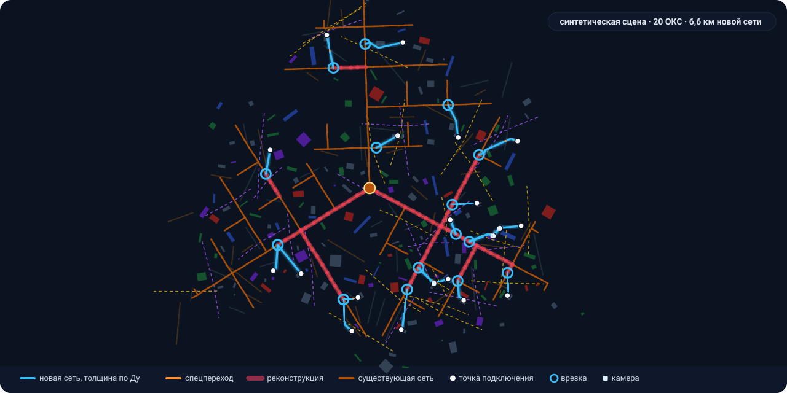
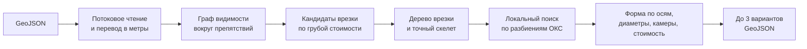
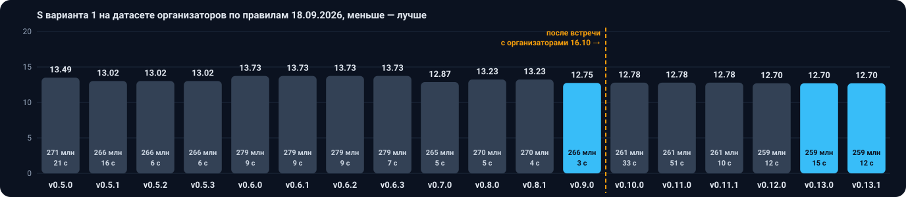

<div align="center">

# Трассировка тепловых сетей

**Сервис сам прокладывает трассы подключения новых зданий к тепловой сети Москвы: выбирает точки врезки, обходит препятствия, подбирает диаметры по расходу и длине, считает стоимость и показатель S и отдаёт до трёх вариантов в одном GeoJSON.**

[](pom.xml)
[](pom.xml)
[](docker-compose.yml)
<br>
[](CHANGELOG.md)
[](CHANGELOG.md)
[](tools/validator/check18.py)

[Быстрый старт](#-быстрый-старт) ·
[Как считает](#-как-считает) ·
[API](#-api) ·
[Версии](CHANGELOG.md) ·
[Документация](#-документация)

**Как запустить и проверить — [INSTRUCTION.md](INSTRUCTION.md)** · **Сопроводительная документация — [docs/DOCUMENTATION.md](docs/DOCUMENTATION.md)**

<br>



<sub>Вариант 1 на синтетической сцене из генератора: голубым новая сеть, оранжевым существующая сеть. Датасет организаторов не показывается, картинка пересобирается командой <code>scripts/readme_assets.py</code>.</sub>

</div>

## 🧭 Что это

Решение кейса ДИТ Москвы на конкурсе «Лидеры цифровой трансформации» 2026: сервис, который проектирует подключение новых зданий к существующей тепловой сети города.

Инженер загружает один GeoJSON: существующую сеть с камерами и источником, точки подключения новых зданий и всё, что мешает прокладке, — застройку, дороги, трамвайные пути, газопроводы, кабели, парки, воду. Без ручной подготовки маршрутов сервис сам строит новую сеть сразу для всех зданий:

- выбирает, где врезаться в существующую сеть и какие здания подключить общими ветками;
- прокладывает трассы в обход препятствий по правилам кейса;
- подбирает диаметры труб по расходу и считает стоимость строительства;
- предлагает до трёх разных вариантов и ранжирует их по показателю S, который сочетает стоимость и длину сети;
- по запросу строит профиль трубы по глубине с обходом подземных коммуникаций;
- отдаёт результат одним GeoJSON и показывает его в 3D на платформе инженера «Тепломаршрут».

Сервис справляется и с кварталом, и с целым городом, одинаковый вход всегда даёт одинаковый результат. Соответствие результата правилам кейса проверяет независимый проверщик [check18](tools/validator/check18.py). Сами правила — в [CONSTRAINTS.md](docs/architecture/CONSTRAINTS.md).

## 🚀 Быстрый старт

Нужен Docker с compose; для расчёта из командной строки ещё JDK 11 и [uv](https://docs.astral.sh/uv/). Подробно — в [INSTRUCTION.md](INSTRUCTION.md).

```bash
make up
curl -s -X POST -H 'Content-Type: application/geo+json' \
  --data-binary @data/samples/small-1.geojson http://localhost:8080/api/v1/jobs
curl -s http://localhost:8080/api/v1/jobs/<id>
curl -s http://localhost:8080/api/v1/jobs/<id>/result -o result.geojson
```

Посчитать файл без веба и базы и сразу проверить выход проверщиком:

```bash
make run IN=data/samples/small-1.geojson OUT=data/out/small-1.geojson
```

Swagger UI — `http://localhost:8080/swagger-ui/index.html`, все команды — `make help`.

**Тепломаршрут — платформа инженера в 3D** ([platform/README.md](platform/README.md)): после `make up` открывается на `http://localhost:8080/`, без сервиса — `make platform` и `http://localhost:8091/`. Трубы под землёй объёмом, продольный профиль, пролёт вдоль трассы, проблемы по высоте, сравнение вариантов, светлая и тёмная тема.

## ⚙️ Как считает



Маршруты ищутся по графу видимости вокруг препятствий с отступами, здания присоединяются к дереву врезки по одному, скелет дерева уточняется точной динамикой по сеткам мест камер, локальный поиск переставляет здания между врезками. Готовые варианты доводятся до строгой формы и получают диаметры, камеры и стоимость. Вход из тысяч зданий считается по районам параллельно.

Пошагово, с таблицей «правило → как соблюдается → проверка» и угловыми случаями — [algorithm.md](docs/algorithm.md); по классам — [ARCHITECTURE.md](docs/architecture/ARCHITECTURE.md); глубина — [depth-optimization.md](docs/depth-optimization.md).

## 📈 Версии

<div align="center">

</div>

Текущая версия **v0.11.1** (18.10.2026): на датасете организаторов S вариантов 12,7841 / 12,9981 / 13,1185, стоимость варианта 1 — 260,9 млн руб., все 17 точек подключены, `check18` без замечаний, расчёт около 10 с на ноутбуке. Все версии, замеры и что менялось — в [CHANGELOG.md](CHANGELOG.md).

## 🔌 API

| Запрос | Что делает |
|---|---|
| `POST /api/v1/jobs` | принимает GeoJSON телом запроса, ставит задачу в очередь, отвечает `202` с `id`; `?depth=true` — расчёт с учётом глубины |
| `GET /api/v1/jobs` | список задач, новые первыми |
| `GET /api/v1/jobs/{id}` | статус `QUEUED`, `RUNNING`, `DONE` или `FAILED`, ошибки входа по объектам, после `DONE` сводки вариантов |
| `GET /api/v1/jobs/{id}/result` | выходной GeoJSON; `409`, пока задача не готова |
| `GET /api/v1/jobs/{id}/input` | исходный файл байт в байт |

Невалидный вход не считается: задача получает `FAILED` со списком проблем «объект, поле, что не так». Формат выхода — в разделе 13 [CONSTRAINTS.md](docs/architecture/CONSTRAINTS.md), поля сводки и критериев — в [BACKEND.md](docs/architecture/BACKEND.md).

## ✅ Проверка качества

| Проверка | Команда |
|---|---|
| Юнит-тесты, без Docker | `make test-unit` |
| Юнит- и интеграционные тесты с PostgreSQL | `make test-java` |
| Проверщик выхода по правилам 18.09.2026 | `make validate IN=… OUT=…` |
| Датасет организаторов: расчёт и проверка | `make real` (датасет кладут в `data/real/dataset.geojson`) |
| Оба датасета организаторов, сцены «густо», город | `scripts/check.sh organizers`, `dense`, `city` |
| Стенд качества: S, стоимость, время | `scripts/bench.sh <метка>` |

## 📚 Документация

| Документ | Что в нём |
|---|---|
| [INSTRUCTION.md](INSTRUCTION.md) | как запустить сервис, проверить результат, посчитать большой файл, что делать, если не работает |
| [docs/DOCUMENTATION.md](docs/DOCUMENTATION.md) | сопроводительная документация в одном файле: алгоритм, ОКС без маршрута, выход, глубина, границы применения |
| [CHANGELOG.md](CHANGELOG.md) | история версий: S, стоимость и время по версиям, город |
| [docs/TASK.md](docs/TASK.md) | задача хакатона, требования заказчика, статус по каждому |
| [docs/architecture/CONSTRAINTS.md](docs/architecture/CONSTRAINTS.md) | правила кейса из документов организатора и их редакции |
| [docs/algorithm.md](docs/algorithm.md) | как работает алгоритм и как соблюдается каждое правило, угловые случаи с картинками |
| [docs/architecture/ARCHITECTURE.md](docs/architecture/ARCHITECTURE.md) | устройство сервиса и расчёт по классам |
| [docs/architecture/BACKEND.md](docs/architecture/BACKEND.md) | API, критерии, сборка, переменные окружения, границы применения |
| [docs/depth-optimization.md](docs/depth-optimization.md) | режим с учётом глубины: правила, оптимальность профиля, замеры |
| [platform/README.md](platform/README.md) | платформа инженера «Тепломаршрут»: запуск, управление, что на экране |
| [docs/README.md](docs/README.md) | все остальные документы: толкования правил, поиск алгоритма, замеры, ADR, реальные города |

## 🗂️ Состав репозитория

| Путь | Что там |
|---|---|
| `src/main/java/ru/lct/heatnet/` | сервис на Java 11 и Spring Boot; тесты — `src/test/java/` |
| `rules/rules.json` | все таблицы и коэффициенты кейса; Java и проверщик читают только этот файл |
| `platform/` | платформа инженера «Тепломаршрут»: 3D-просмотр, профиль, варианты; сервис отдаёт её на `/` |
| `tools/` | Python одним uv-проектом: генератор синтетики `synth/` и проверщик `validator/check18.py` |
| `scripts/` | проверки качества (`check.sh`, `bench.sh`, `depth_bench.sh`), офлайн-карта результата, картинки документации |
| `docs/` | документация; `docs/architecture/` — правила кейса и устройство сервиса |
| `data/samples/` | небольшие входы для пробы; датасет организаторов кладут в `data/real/dataset.geojson` |
| `Makefile`, `pom.xml`, `build.gradle`, `Dockerfile`, `docker-compose.yml` | сборка Maven или Gradle, приложение и PostgreSQL в одном compose |

Как вносить изменения и выпускать версии — [docs/CONTRIBUTING.md](docs/CONTRIBUTING.md).

<br>

<div align="center">
<sub>Лидеры цифровой трансформации 2026 · кейс Департамента информационных технологий Москвы</sub>
</div>
