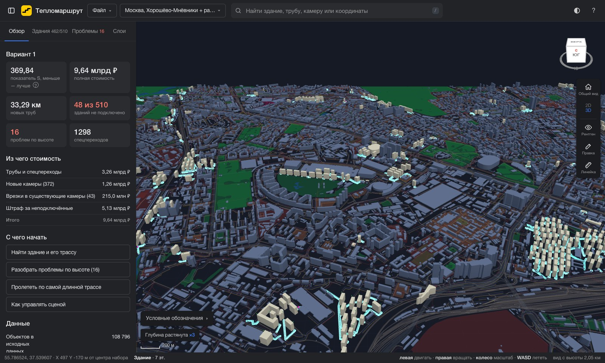
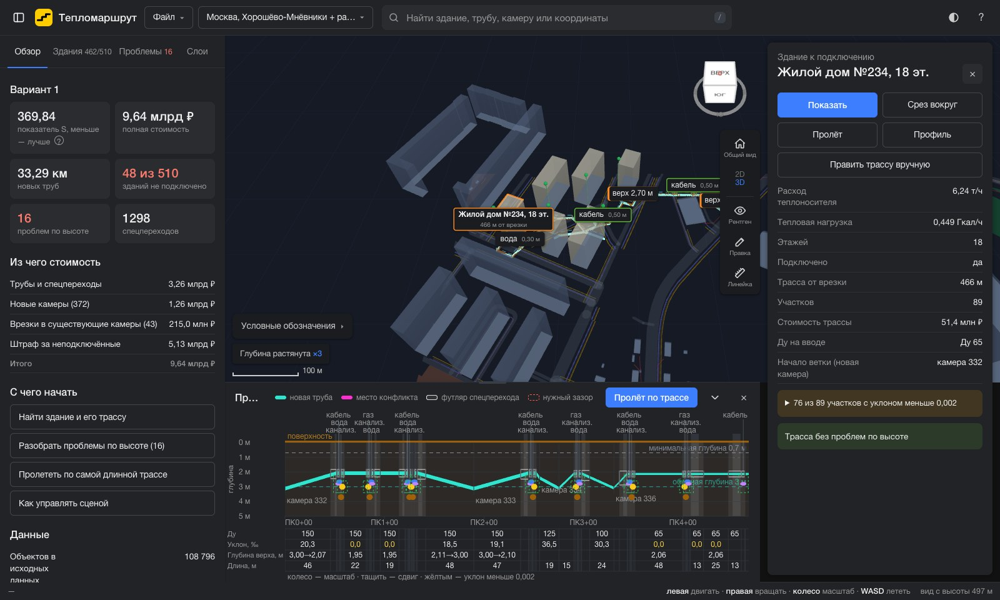
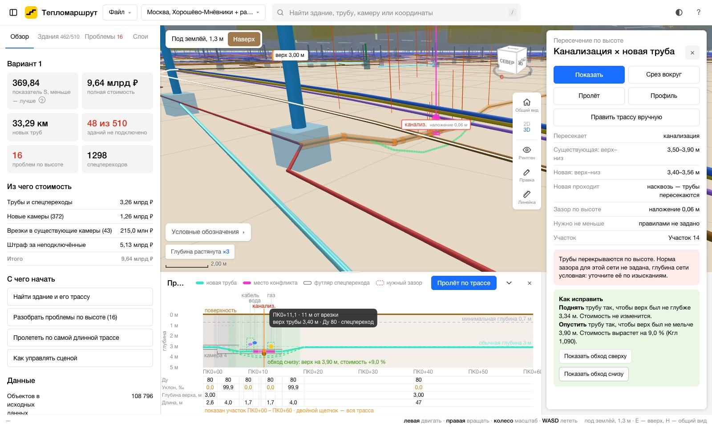
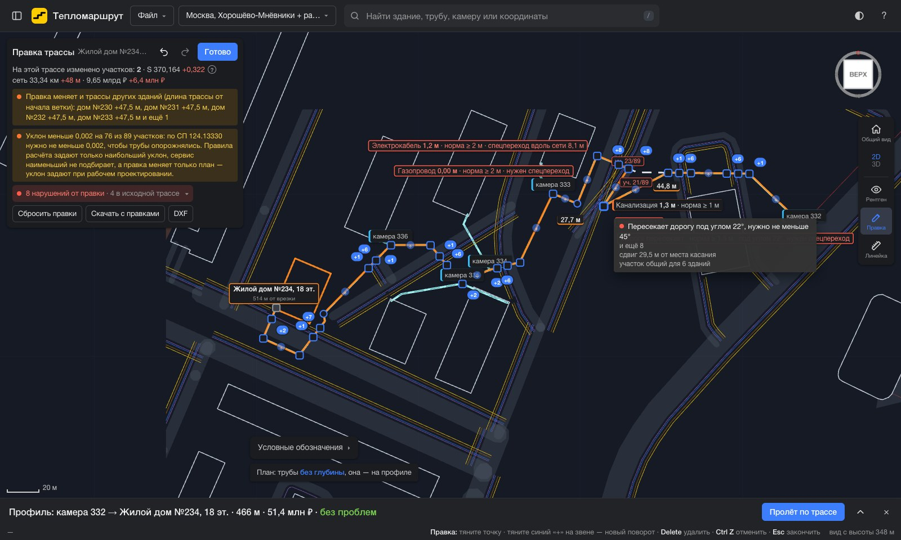

# Тепломаршрут — платформа инженера

Тепломаршрут показывает результат сервиса трассировки так, как его разбирает инженер тепловых сетей: в объёме, под землёй, рядом с газом, кабелями, водопроводом, канализацией и существующей теплосетью. На платформе можно открыть трассу любого здания, увидеть её продольный профиль, найти пересечения по высоте и способ их обойти, сравнить варианты, поправить трассу вручную с проверкой норм и выгрузить результат в AutoCAD.

Запуск, управление с клавиатуры и мыши, устройство кода — в [platform/README.md](../platform/README.md).

Все снимки на этой странице — район Москвы Хорошёво-Мнёвники с источником ТЭЦ-16. Вход собран по открытым данным OpenStreetMap ([data/cities/moscow](../data/cities/moscow/README.md)), посчитан сервисом в режиме с учётом глубины (`--depth`) и открыт на платформе как свои файлы.

## Город целиком



- Сцена строится из того же GeoJSON, что получает сервис: здания объёмом по этажности, дороги, парки, вода, существующие сети. Здания к подключению выделены, новая сеть — бирюзовая.
- Слева «Обзор» варианта: показатель S, полная стоимость, длина новых труб, сколько зданий не подключено, сколько проблем по высоте и спецпереходов, из чего сложилась стоимость.
- На снимке район на 108 796 объектов исходных данных, 510 зданий к подключению и 33 км новых труб. Платформа открывает его в обычном браузере.
- Интернет не нужен: three.js лежит в репозитории, данные читаются из файлов или с сервиса.

## Трасса здания и продольный профиль



- Щелчок по зданию подсвечивает его трассу от врезки до ввода. В карточке — расход теплоносителя, тепловая нагрузка, длина и стоимость трассы, Ду на вводе, откуда начинается ветка.
- Снизу продольный профиль, как Profile View в Civil 3D: глубина верха трубы по длине, пересекаемые коммуникации с зоной нужного зазора, дороги и спецпереходы, пикетаж и подвал «Ду / уклон / глубина верха / длина».
- На снимке видно, как работает режим глубины: у пересечений с кабелем, газом, водой и канализацией труба поднимается выше коммуникаций, а между ними возвращается на обычную глубину 3 м.
- Наведение на профиль показывает эту точку в 3D, щелчок переносит туда камеру. «Пролёт по трассе» ведёт камеру вдоль трубы от врезки до здания.

## Пересечения по высоте



- Вкладка «Проблемы» собирает пересечения с недостаточным зазором, а также проблемы уклона и глубины.
- В карточке пересечения — глубина верха и низа обеих труб, зазор между ними и норма.
- Платформа предлагает два способа исправить: поднять трубу не глубже одной отметки или опустить не мельче другой, и пишет, как изменится стоимость из-за коэффициента глубины. Кнопки «Показать обход сверху» и «Показать обход снизу» рисуют обход в 3D и на профиле. На снимке — обход канализации снизу: верх трубы на 3,90 м, стоимость вырастет на 9 % (коэффициент глубины 1,09).
- Трубы нарисованы в настоящем габарите по Таблице 1. Вертикаль можно растянуть, чтобы увидеть глубины, диаметры при этом не меняются. Рентген делает землю и здания прозрачными, «Срез вокруг» оставляет на сцене только куб вокруг выбранного места.

## Ручная правка трассы



<sub>На снимке инженер сдвинул узел трассы с места, которое выбрал сервис. Платформа сразу показывает, какие нормы теперь нарушены, и пересчитывает стоимость и S.</sub>

- «Правка» переводит сцену в план. Точки поворотов, узлов и камер можно тянуть, на звене можно добавить новый поворот, лишний — удалить. Звенья липнут к прямым углам, как «Орто» в AutoCAD.
- У выбранной точки видны длины соседних звеньев, угол поворота и выноски до ближайших зданий, зон запрета, дорог и сетей с расстоянием и нормой. Зелёная выноска — норма соблюдена, оранжевая — запас меньше 1 м, красная — нарушение.
- Проверки те же, что у проверщика `check18`: отступы от зданий и зон запрета, дороги и сети ближе нормы только спецпереходом, переход дороги не острее 45°, повороты не круче 90°, лишние повороты, предельная длина пути, зазоры по высоте.
- Длина, стоимость и S пересчитываются на ходу. Если правка задевает общий участок, панель пишет, трассы каких ещё зданий изменились и на сколько.
- Результат с правками скачивается как GeoJSON в формате выхода сервиса, его можно проверить `check18`. Для AutoCAD и Civil 3D есть выгрузка в DXF: отдельные слои для новой сети, правок, спецпереходов, камер, подписей, существующих сетей, зданий и нарушений, кириллица в подписях читается без искажений.

## Что ещё умеет

- **Варианты.** Сводная таблица по S, стоимости, длине, неподключённым зданиям и проблемам. Другой вариант можно наложить на текущий пунктиром.
- **Свои данные и расчёт.** Демо-наборы открываются сразу. Свои GeoJSON можно перетащить в окно: платформа сама поймёт, где исходные данные, а где результат. С адреса сервиса можно запустить новый расчёт, в том числе с учётом глубины, и открыть историю расчётов.
- **Поиск и навигация.** Поиск по номеру здания, участка, камеры, по адресу или координатам. Меню «что здесь» по правому щелчку, линейка, куб видов, режим полёта на W A S D.
- **Ссылка на вид.** Адрес страницы хранит набор, вариант, выбранный объект и положение камеры. Коллега по ссылке увидит то же самое.
- **Телефон и планшет.** Отдельные раскладки и жесты: панели выдвигаются, карточка становится нижним листом, правка трассы работает пальцем.
- **Светлая и тёмная тема** или как в системе.
- **Привычное управление.** Мышь и клавиши устроены как в Google Картах, AutoCAD, Revit, Navisworks и Civil 3D, чтобы инженеру не пришлось переучиваться. Почему именно так — [platform/docs/DESIGN.md](../platform/docs/DESIGN.md).

## Как открыть

```bash
make up          # сервис с базой, платформа на http://localhost:8080
make platform    # только платформа с демо-наборами, http://localhost:8091
```

Нужен браузер с WebGL 2: Chrome, Edge, Firefox или Safari 15+. Подробно — в [platform/README.md](../platform/README.md).
